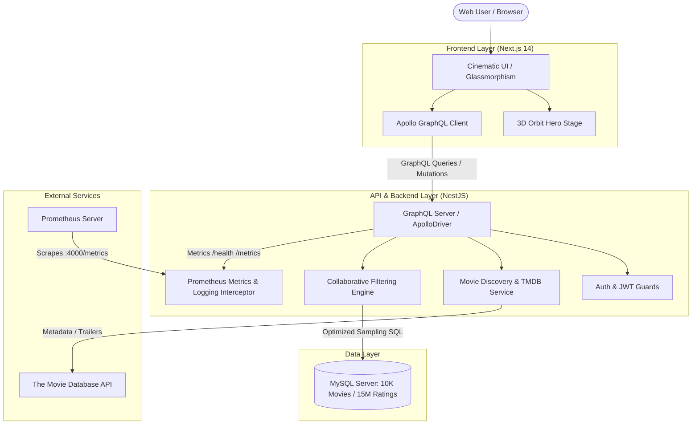

# CineScope — Movie Recommendation System

[](https://github.com/godwin224767-a11y/CineScope-Movie_Recommendation_System/actions/workflows/ci.yml)
[](https://opensource.org/licenses/MIT)
[](https://nextjs.org/)
[](https://nestjs.com/)
[](https://graphql.org/)
[](https://www.mysql.com/)
[](https://prometheus.io/)

**CineScope** is a high-performance, enterprise-grade web-based **Movie Recommendation System**. It combines a sleek, modern Next.js frontend with an optimized NestJS GraphQL backend, connected to a relational MySQL database containing over 10,000 movies and 15,000,000 user ratings.

---

## 🌟 Architecture & Tech Stack



### Technology Matrix (As Specified in Project Guidelines)

| Component | Technology | Implementation Details |
| :--- | :--- | :--- |
| **Frontend** | **Next.js 14 (React)** | App Router, SSR/Client components, Responsive Dark Theme |
| **UI / Styling** | **Vanilla CSS3 & Tailwind** | Custom 61KB cinematic stylesheet, Glassmorphism, 3D CSS transforms |
| **Backend** | **NestJS (TypeScript)** | Modular architecture, Dependency Injection, Validation Pipes |
| **API Layer** | **GraphQL** | Apollo Server code-first resolvers, Typed schemas, Mutations & Queries |
| **Database** | **MySQL Server** | Relational schema with index optimization for 15M rating records |
| **Containerization** | **Docker** | Multi-stage Dockerfiles (`backend/Dockerfile`, `frontend/Dockerfile`, `docker-compose.yml`) |
| **CI/CD** | **GitHub Actions** | Automated CI pipeline (`.github/workflows/ci.yml`) for lint, build, test, and container checks |
| **Deployment** | **Kubernetes / Minikube** | Production manifests in `k8s/` (Deployments, Services, Ingress, ConfigMaps, Secrets, PVCs) |
| **Monitoring** | **Prometheus & Logging** | Prometheus `/metrics` endpoint with latency histograms, health check probe `/health` |

---

## 🚀 Key Features

### 🎬 1. Cinematic Hero Stage & Discovery
- **3D Orbital Cinema Stage**: 3D tilted stage powered by CSS 3D transforms and GSAP animations, featuring a central glowing TV monitor with rotating poster ring.
- **Dynamic Search & Discovery**:
  - **Title Search**: Sub-second search across the local database augmented with live TMDB search.
  - **Genre Explorer**: Interactive multi-genre filter chips with live movie count.
  - **Regional Language Discovery**: Discover top-grossing films across 14 languages (Hindi, Telugu, Tamil, Malayalam, Spanish, French, Korean, Japanese, etc.).
  - **Year Range Slider**: Granular filter for release years (1900–2030).

### 🧠 2. Collaborative Filtering Recommendation Engine
- Analyzes taste profiles from a pool of users who positively rated (≥ 4.0) target movies.
- High-performance sampling queries engineered for low latency on multi-million row datasets.
- Fallback content-based genre correlation for cold-start scenarios.

### 👤 3. User Authentication, Profiles & Wishlist
- **JWT & Cookie Authentication**: Secure bcrypt password hashing and token validation.
- **My List & Wishlist**: Bookmarking system across all movies and live discovery cards.
- **User Reviews & Community Ratings**: Star rating widget (0–5 stars), community reviews, and user management.

### 🛡️ 4. Administrative Control Layer
- Protected GraphQL mutations requiring admin role (`GqlAdminGuard`).
- Add new movies with metadata, release year, posters, and genre links.
- Remove inappropriate reviews, delete malicious user ratings, and manage database integrity.

---

## 📁 Repository Structure

```text
├── backend/                       # NestJS 10 GraphQL Application
│   ├── src/
│   │   ├── auth/                  # JWT auth, guards, resolvers, DTOs
│   │   ├── movies/                # Movies resolver, recommendation service, TMDB proxy
│   │   ├── wishlist/              # Wishlist service & resolver
│   │   ├── reviews/               # Reviews service & resolver
│   │   ├── admin/                 # Admin operations resolver
│   │   ├── common/                # Monitoring (/metrics, /health), Logging interceptor, Error filters
│   │   ├── database/              # MySQL connection pool service
│   │   ├── app.module.ts          # Main application module with ApolloDriver
│   │   └── main.ts                # Application bootstrap
│   ├── Dockerfile                 # Production multi-stage Docker build
│   └── tsconfig.json
├── frontend/                      # Next.js 14 Application
│   ├── public/                    # Static assets & public media
│   ├── src/
│   │   ├── app/                   # Next.js App Router (Home, /movie/[id], /mylist)
│   │   ├── components/            # HeroOrbit, SearchSection, MovieCard, Modals, Navbar
│   │   ├── lib/                   # Apollo client, Auth context, Wishlist context
│   │   └── styles/                # Master style.css (emerald green & obsidian slate theme)
│   ├── Dockerfile                 # Production multi-stage Docker build
│   └── next.config.js
├── database/                      # Relational Database Schemas & Queries
│   ├── schema.sql                 # Production MySQL schema & index definitions
│   └── database_setup.sql         # Setup & analytical queries
├── scripts/                       # Maintenance & Utility Scripts
│   ├── setup_database.py          # Automated database initialization
│   ├── create_admin.py            # CLI tool to promote users to administrator
│   ├── view_db.py                 # CLI database inspector & diagnostic tool
│   └── import_movielens_32m.py    # MovieLens 32M ETL script
├── k8s/                           # Kubernetes & Minikube Manifests
│   ├── namespace.yaml             # cinescope namespace
│   ├── configmap.yaml             # Environment configuration
│   ├── mysql-deployment.yaml      # MySQL Deployment + PVC + Service
│   ├── backend-deployment.yaml    # NestJS Deployment + Service (with /health & /metrics)
│   ├── frontend-deployment.yaml   # Next.js Deployment + NodePort Service
│   ├── ingress.yaml               # Ingress routing rules
│   └── kustomization.yaml
├── monitoring/
│   └── prometheus.yml             # Prometheus scraping configuration
├── legacy-flask/                  # Archived Legacy Python Flask Implementation
├── .github/
│   └── workflows/
│       └── ci.yml                 # GitHub Actions CI/CD Pipeline
├── docker-compose.yml             # Fullstack container composition (MySQL, Backend, Frontend, Prometheus)
├── package.json                   # Root orchestrator scripts (dev, build, start)
├── .env.example                   # Environment configuration template
└── README.md
```

---

## 🛠️ Local Development & Quick Start

### Prerequisites
- **Node.js**: v18.x or v20.x+
- **MySQL Server**: running locally (or via Docker)
- **Git**

### 1. Environment Configuration
Ensure your `.env` in the project root is configured:
```ini
SECRET_KEY=super-secret-key-123
TMDB_API_KEY=your_tmdb_api_key_here
DB_HOST=localhost
DB_USER=root
DB_PASSWORD=your_mysql_password
DB_NAME=movie_recommendation_system
```

### 2. Run NestJS Backend
```bash
cd backend
npm install
npm run start:dev
```
- GraphQL Playground: [http://localhost:4000/graphql](http://localhost:4000/graphql)
- Prometheus Metrics: [http://localhost:4000/metrics](http://localhost:4000/metrics)
- Health Check: [http://localhost:4000/health](http://localhost:4000/health)

### 3. Run Next.js Frontend
In a new terminal window:
```bash
cd frontend
npm install
npm run dev
```
- Open [http://localhost:3000](http://localhost:3000) in your browser!

---

## 🐳 Docker Containerization

To run the entire multi-container stack (MySQL, NestJS Backend, Next.js Frontend, Prometheus) with one command:

```bash
docker compose up --build
```

- **Frontend**: [http://localhost:3000](http://localhost:3000)
- **Backend GraphQL**: [http://localhost:4000/graphql](http://localhost:4000/graphql)
- **Prometheus Dashboard**: [http://localhost:9090](http://localhost:9090)

To stop the containers:
```bash
docker compose down
```

---

## ☸️ Kubernetes / Minikube Deployment

1. Start Minikube and enable the Ingress addon:
```bash
minikube start
minikube addons enable ingress
```

2. Point Docker CLI to Minikube:
```bash
# Windows PowerShell
& minikube -p minikube docker-env --shell powershell | Invoke-Expression

# macOS/Linux
eval $(minikube docker-env)
```

3. Build images into Minikube:
```bash
docker build -t cinescope-backend:latest ./backend
docker build -t cinescope-frontend:latest ./frontend
```

4. Deploy the Kubernetes manifests:
```bash
kubectl apply -k ./k8s
```

5. Verify running pods:
```bash
kubectl get pods -n cinescope
```

---

## 📊 Monitoring & Logging

- **Metrics Collection**: NestJS backend exposes standard and custom Prometheus metrics at `/metrics` (HTTP request count, GraphQL operation durations, latency histograms).
- **Health Checks**: `/health` endpoint checks database connectivity, latency in milliseconds, process uptime, and memory usage.
- **Structured Logging**: Logging interceptor traces all incoming GraphQL queries and mutations with execution duration.

---

## 👨‍💻 Administrative Commands & Login

- **Default Admin Account**:
  - Username: `admin`
  - Password: `admin123`
- Admins have access to the **"➕ Add Movie (Admin)"** modal and the **"Remove Movie"** action on movie detail pages.

---

## 🛡️ License
This project is licensed under the MIT License.
